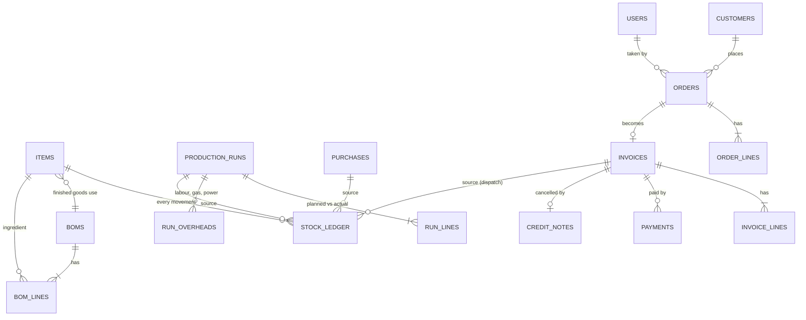

# Design note

## Data model

`raw`, `pack` and `fg` stock all live in one `items` table, distinguished by `kind`. That keeps the ledger to a single table and lets one query produce all three stock reports. A finished product points at a BOM through `items.bom_id`, so two pack sizes can share one recipe.

Quantities are integers in thousandths of the item's stock unit (40 kg is 40000). Money is integer paise. Neither ever passes through a float. Anything that divides (tax, weighted average, cost per packet) does it in Decimal with half-up rounding and turns the result back into an integer straight away.

## How stock is computed

`stock_ledger` is the only place stock exists. A balance is `SUM(qty_m)` over an item's rows, calculated whenever it is needed, so no code can overwrite a number. Each row carries the source document (`source_type`, `source_id`): a purchase, production run, invoice, credit note, reversal or adjustment. The opening-balance rows are the only ones without a source id.

The stock summary report is one query that splits the same rows into opening, receipts, issues, adjustments and closing for the chosen dates, so opening + receipts - issues +/- adjustments = closing holds by construction (a test checks it).

Writes happen inside one SQLite transaction per business action. `stock.post` refuses any issue that would take a balance below zero, which rolls back the whole action. A run with too little flour leaves no run, no partial issues and no finished goods behind.

## How a production run consumes the BOM

1. Planned quantity for each BOM line is the per-batch quantity times the number of batches. Expected output is the BOM yield times the batches.
2. The supervisor enters what was actually issued for each line (in kg, g, l, ml, pieces or cartons; the server converts to the item's stock unit), plus good packets and damaged pouches. Lines marked `per_packet` (the pouch) are issued automatically as good plus damaged, which is how 188 + 6 = 194 pouches leave stock.
3. Each issue is posted to the ledger and valued at the item's weighted average at that moment. Planned, actual and cost are kept on `run_lines`.
4. Good packets go into finished goods at the total material cost of the run.
5. Variance is `(actual - planned) / planned` as a percentage. It is flagged when its absolute value is greater than the tolerance in settings (3%). Yield uses the same rule, comparing good packets to expected.
6. Reversing a run posts the opposite of every ledger row with the exact original values. It fails if the finished goods have already been sold.

## Costing and valuation

Method: weighted average cost, kept per item. A receipt adds its quantity and value. An issue takes `quantity x (balance value / balance quantity)`, with the balance cleared exactly when the last unit leaves so no paise are stranded. I chose it over FIFO because the factory buys flour and oil in a few lots a month and the owner wants one stable cost per packet, not one that depends on which lot happened to be at the front. It also needs no per-lot bookkeeping. The cost is that a price spike is smoothed out rather than hitting the next batch immediately.

Overheads (labour, gas, power) are recorded against the run they belong to and charged to it in full. With one product per run, direct assignment needs no allocation key. If two products shared a run, the sensible key would be machine hours or, failing that, share of output weight. Each overhead is also posted as a quantity-less ledger row so finished-goods value includes it.

Cost per packet = (materials + overheads) / good packets, unrounded until it is shown. Margin is the selling price before tax minus that figure. For the benchmark run it is 5,855.00 / 188 = Rs 31.14, a margin of Rs 18.86.

## Sales and tax

An order moves submitted, approved, invoiced, dispatched. Approval compares the order with finished goods minus what other approved orders have already claimed, and refuses to proceed on a shortage. The admin edits the quantity or rejects. Invoice numbers are `INV/<financial year>/<sequence>` from a counter table, with the year running April to March.

Tax is rounded once per line on the taxable value. Intra-state, CGST gets half rounded down and SGST the remainder, so the two always add up to the tax. Inter-state, the whole amount is IGST. Which applies depends on whether the customer's state code equals the factory's.

A posted invoice is never deleted or edited. Cancelling it creates a credit note (`CN/<fy>/<seq>`), returns dispatched stock to the ledger at its original value, and marks the invoice cancelled. Every create, edit, approval, cancel and adjustment writes a row to `audit_log` with the user and time.
